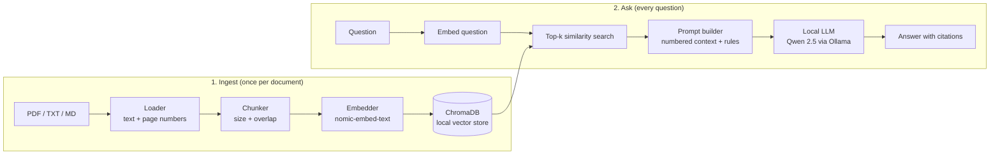

# rag-document-qa

Local, privacy-first document Q&A using Retrieval-Augmented Generation (RAG): chat with your PDFs, fully offline.

Documents are split into chunks, embedded, and stored in a local vector database. When you ask a question, the most relevant chunks are retrieved and handed to a **locally hosted language model (Qwen 2.5 via Ollama by default)**, which answers using only that text and cites its sources. No document, question or answer leaves your computer.

> **About this project.** An independent portfolio/demo project that explores a privacy-first RAG architecture. It uses only synthetic sample documents and contains no code or data from any employer or university. 

## How it works



Why this design:

- **Private by construction.** Model, embeddings and vector database all run on your machine; ChromaDB telemetry is switched off.
- **Grounded answers.** The model is instructed to answer only from the retrieved passages and to say *"I could not find this in the provided documents."* otherwise. Every answer shows the exact passages (file, page, similarity) it used.
- **Pluggable model.** The language model sits behind a two-method interface, so changing models is a one-line config change (see [Switching models](#switching-models)).

## Quick start

Requires **Python 3.10 or newer** (check with `python3 --version`).

### 1. Install Ollama and the models

Install [Ollama](https://ollama.com), then pull a language model and an embedding model:

```bash
ollama pull qwen2.5:3b          # language model (about 2 GB; needs roughly 8 GB RAM)
ollama pull nomic-embed-text    # embedding model (small)
```

Prefer a stronger model and have the memory for it? `ollama pull qwen2.5:7b` and set `llm.model: qwen2.5:7b` in `config.yaml`.

### 2. Install the project

```bash
python -m venv .venv
source .venv/bin/activate          # Windows: .venv\Scripts\activate
pip install -e .
```

### 3. Check your setup

```bash
ragqa doctor
```

It reports whether the Ollama server is running and the configured models are installed, and prints the exact command that fixes anything missing.

### 4. Run it

**Web app**

```bash
streamlit run app.py
```

Upload your own PDF, TXT or MD files in the sidebar. They are indexed automatically. Then type a question in the chat box. Open **Sources** under an answer to see the passages behind it. (The sidebar also has an optional *Try the bundled sample documents* section.)

**Command line**

```bash
ragqa ingest sample_docs
ragqa ask "How many days of annual leave do full-time employees get?"
ragqa ask "How quickly must a lost laptop be reported?" --show-scores
ragqa sources          # what is indexed
ragqa reset            # clear the index
```

**No Ollama yet?** Add `--offline` (CLI) or switch on *Offline demo mode* (web app). It uses a tiny built-in embedder and *quotes* matching sentences instead of generating text. It is useful to see the pipeline run, but answers are much weaker than with a real model (it matches words, not meaning).

## Switching models

All settings live in [`config.yaml`](config.yaml). Change one line:

```yaml
llm:
  model: qwen2.5:7b        # or llama3.2:3b, mistral, ... anything Ollama serves
```

Or override without editing the file: `RAGQA_LLM_MODEL=llama3.2:3b streamlit run app.py`.

To use a model server you host yourself (for example [vLLM](https://docs.vllm.ai) on a GPU machine), set `llm.provider: openai_compat` and point `llm.base_url` at it. It must expose the OpenAI-compatible `/v1/chat/completions` endpoint.

## Settings that matter

| Setting | Default | What it does |
| --- | --- | --- |
| `chunking.chunk_size` | 800 chars | Size of each indexed passage. Too large blurs meaning; too small loses context. |
| `chunking.chunk_overlap` | 120 chars | Text shared by neighbouring chunks so answers on a boundary are not cut in half. |
| `retrieval.top_k` | 4 | How many passages are given to the model. Too few can miss the answer; too many add noise. |
| `retrieval.min_score` | `auto` | Similarity floor. If no passage reaches it, the app says "not found" without calling the model. |
| `llm.temperature` | 0.1 | Low = factual and repeatable. |
| `llm.num_ctx` | 4096 | Context window requested from Ollama. It must fit the retrieved passages plus the question. |

Changing any chunking setting requires re-indexing the documents.

## Evaluating retrieval

`ragqa.evaluate` measures the search step on a question set with known answers ([`eval/qa_set.jsonl`](eval/qa_set.jsonl): 16 answerable and 4 unanswerable questions over the sample documents):

```bash
python -m ragqa.evaluate --offline            # no model server needed
python -m ragqa.evaluate -k 2                 # try a different top_k
python -m ragqa.evaluate --answers            # also generate answers with your configured model
```

Measured with the offline embedder on the bundled sample documents:

| Metric | Result |
| --- | --- |
| hit@4 (correct file in top 4) | 100% |
| evidence@4 (expected phrase in a top-4 passage) | 100% |
| MRR (rank of first evidence passage) | 0.97 |
| Answerable questions wrongly refused | 0% |
| Unanswerable questions correctly refused by the similarity floor | 0% |

Read these numbers with care:

- The sample set is small and the questions share vocabulary with the documents, so this is a regression check, **not a benchmark**. Use your own documents and questions for real conclusions.
- The last row is a genuine limitation: with the offline embedder, the best-match scores of answerable questions (0.15 to 0.44) and unanswerable ones (0.05 to 0.16) overlap, so **no single similarity floor separates them**. The report prints this overlap. The prompt's "say you could not find it" rule is the second line of defence, and a neural embedder should separate better; measure it on your own data with `--show-scores`.
- `--answers` checks that the expected phrase appears in the generated answer. That is a rough, lenient check (a wrong sentence can contain the same phrase). Review answers by eye for real quality.

## Project structure

```
app.py                      Streamlit chat UI
config.yaml                 every tunable setting
src/ragqa/
    loaders.py              PDF/TXT/MD -> pages with source + page number
    chunking.py             recursive splitter with overlap, stable chunk ids
    embeddings.py           Ollama embedder (default) and offline hash embedder
    vectorstore.py          ChromaDB wrapper (cosine similarity, local, no telemetry)
    prompts.py              grounded prompt with numbered context and a way out
    llm.py                  pluggable LLM backends: Ollama, OpenAI-compatible, extractive
    pipeline.py             ingest + retrieve + answer, ties it all together
    evaluate.py             retrieval metrics
    doctor.py, cli.py       setup check and command line
tests/                      93 tests, including a fake Ollama HTTP server
sample_docs/                synthetic documents (md, txt, pdf) for demos and tests
eval/qa_set.jsonl           questions with expected sources and evidence phrases
docs/HOW_IT_WORKS.md        guided tour of the code
```

## Testing

```bash
pip install -e ".[dev]"
pytest
```

The tests cover config validation, chunking, loaders (including PDF), embeddings, the vector store, prompts, every LLM backend, the full pipeline, the CLI, the setup check and the web UI (headless). The Ollama code paths (request format, model options, streaming, error handling) are tested against a small fake HTTP server in `tests/fake_ollama.py`, so they run anywhere; to verify real answer quality, run the app against a real model with `ragqa doctor` and `python -m ragqa.evaluate --answers`.

## Limitations

- **Scanned PDFs** have no text layer and are skipped (no OCR yet).
- **PDF reading order** is chosen per page: position-based for CVs, forms and tables, column by column for multi-column pages. The multi-column detection is a heuristic and can be wrong on unusual layouts.
- **Tables and complex layouts** lose some of their structure when converted to text.
- **Answers spread across many documents** may need a larger `top_k` or are not synthesised well by small models.
- **Small local models** (such as 3B parameters) are less capable than large hosted models; they can still misread passages, so check the cited sources.
- Single-user, local tool: no authentication or multi-user access control.

## Ideas for next steps

Hybrid search (keyword BM25 plus vectors), a re-ranking step, heading-aware chunking, OCR for scanned PDFs, an LLM-as-judge answer evaluation, and conversation memory for follow-up questions.
